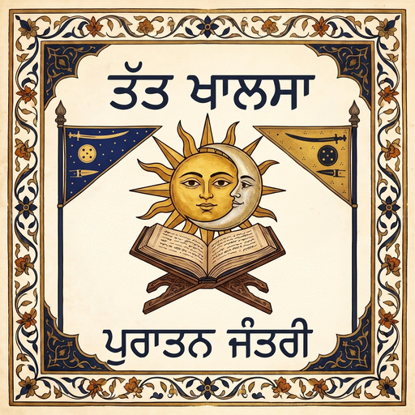

<p align="center">
  
</p>

<h1 align="center">Tatkhalsa Puratan Jantri (ਤੱਤਖ਼ਾਲਸਾ ਪੁਰਾਤਨ ਜੰਤਰੀ)</h1>

<p align="center">
  <strong>Official Puratan Bikrami Sambat Luni-Solar Calendar by Tatkhalsa Foundation</strong><br/>
  Anchored to Sri Anandpur Sahib (IST) · Traditional Sampardai Chronology · Zero Astrology or Fixed Nanakshahi Overrides
</p>

<p align="center">
  <a href="https://calendar.tatkhalsa.in"></a>
  <a href="https://github.com/Tatkhalsa-Foundation/tatkhalsa-puratan-jantri/releases"></a>
  <a href="./LICENSE"></a>
  <a href="./DATA_LICENSE"></a>
</p>

---

## Overview

**Tatkhalsa Puratan Jantri** (`calendar.tatkhalsa.in`) is an open-source, offline-capable Progressive Web App (PWA) built by **Tatkhalsa Foundation** to preserve and present the authentic **Puratan Bikrami Sambat** luni-solar calendar used in Sikh history, *Hukamnamas*, and manuscript colophons.

Rather than substituting modern Gregorian or fixed 2003 Nanakshahi solar dates, the Jantri pairs true sidereal **Desi solar months** (1 Chet through 30 Phagun) with **daily lunar tithis** across *Sudhi* (waxing) and *Vadhi* (waning) fortnights—cross-referenced directly with primary Sikh scriptures and historical texts.

---

## Features

* **Live Dual-Time Hero (*Ajj Da Din*):** Real-time ticking **Sri Anandpur Sahib (IST)** clock synced alongside the user's local device timezone, displaying today's Desi solar date, lunar paksh & tithi, illumination percentage, and tithi transition timing.
* **Interactive Monthly Jantri Grid:** Toggle seamlessly between **Desi Months** and **Gregorian Month Overlay**, filter by category, and inspect **Marked Dates & Colophons** cards.
* **165+ Puratan Observances & Historical Directory:**
  * **Gurpurabs:** Parkash, Gurgaddi, and Joti Jot dates of all Guru Sahibaan & Sri Guru Granth Sahib Ji.
  * **Sahibzade & Guru Ghar Families:** Dedicated tracking for all four Sahibzade (including *29 Maghar* Baba Fateh Singh Ji Parkash Purab), Mata Gujri Ji, Mata Jito Ji, Mata Sahib Kaur Ji, and Guru families.
  * **All 15 Bhagats, 11 Bhatts & Gursikhs:** Commemorations, SGGS Ang references, and *Bhatt Vahi* / *Suraj Prakash* notes.
  * **Panj Pyare, Khalsa Shaheeds & Barsis:** Complete *Shaheedi Hafta* progression, Panj Pyare, *Vadda/Chhota Ghallughara*, *Delhi Fateh*, and traditional *Sampardai* Mahapurakh Barsis.
* **In-App Scriptural & Colophon Reader:** Expandable **Read Full Source / Itihaas** drawers featuring Gurmukhi text, transliteration, English historical notes, and **Barah Maha Majh (SGGS Ang 133–136)** links to `pothi.tatkhalsa.in`.
* **Full 365-Day & Purab `.ics` Export (RFC 5545):** Export either observances only or **every single calendar day** (514+ dates across Sambat 2083–2084) with Desi + lunar dates and Purabs combined into Apple Calendar, Google Calendar, and Outlook.
* **Gregorian → Puratan Bikrami Date Lookup:** Instant bidirectional date conversion with quick historical milestone chips.
* **Sangrands & Barah Maha Reference:** Full sidereal solar ingress (*Sankranti*) schedule anchored to Sri Anandpur Sahib (IST).
* **Print-Ready A4 Jantri Sheet:** Clean, multi-line printable monthly sheet designed for Gurdwaras, homes, and Sangat distribution.
* **Bilingual & Installable PWA:** Instant switching between **English (`EN`)**, **Gurmukhi (`ਪੰ`)**, and **Bilingual (`Both`)** modes with `Noto Sans Gurmukhi` typography, `localStorage` state persistence across refreshes, and a dedicated **Install App** flow for Android, Desktop, and iOS.

---

## Tech Stack

* **Frontend:** React, TypeScript, Tailwind CSS
* **Build & PWA:** Vite, `vite-plugin-pwa` (Workbox offline caching)
* **CI/CD & Hosting:** GitHub Actions (`Build & Push to deploy branch` + automated zipped Releases) → Hostinger (`/public_html/calendar`)

---

## Local Development

### Prerequisites
* Node.js (`v18` or later recommended)
* `npm` (or `bun`)

### Setup & Commands

```bash
# Install dependencies
npm install --legacy-peer-deps

# Start the development server
npm run dev

# Type-check
npm run lint

# Build for production (outputs to ./dist)
npm run build
```
